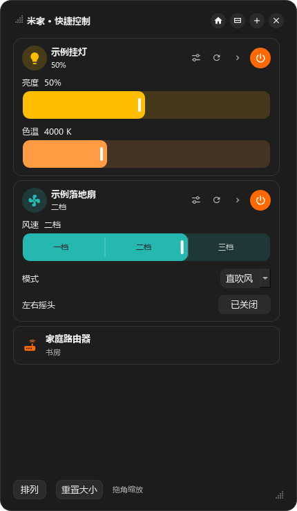
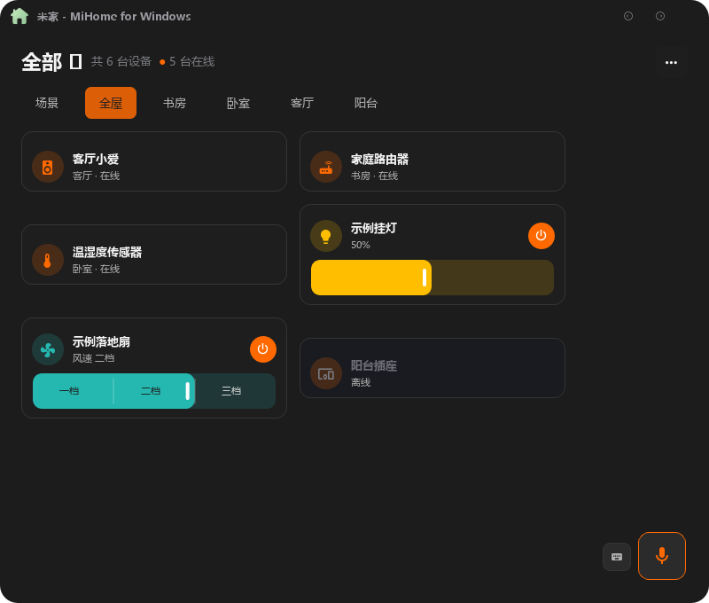

# 米家快捷控制 · MiHome Tray

在 Windows 系统托盘里控制米家设备。点击图标，即可调节挂灯亮度、色温，或控制风扇电源、风速、模式和摇头。

**[下载安装包](https://github.com/INYerty/MiHome-Tray/releases/latest)** · [反馈问题](https://github.com/INYerty/MiHome-Tray/issues) · [开发说明](README.local.md)

## 效果图

以下为 v0.4.1 程序实际渲染的界面截图，使用隔离的演示设备，未包含真实账号或家庭数据。预览使用主题背景，系统支持时浮窗可使用 Windows 11 Acrylic。

### 托盘快捷面板



### 主页面



## 下载与使用

1. 打开 [Releases](https://github.com/INYerty/MiHome-Tray/releases/latest)，下载其中的 `MiHome-Tray-Setup-版本号-x64.exe`。本地构建的新版位于 `dist`，以该目录的实际版本为准。
2. 双击安装，随后从开始菜单打开「米家快捷控制」。**无需安装 Python、下载依赖或解压运行目录。**
3. 用手机米家 App 扫码登录自己的账号。目前面向中国大陆地区账号。
4. 右键右下角托盘图标 →「管理托盘项目」，添加设备；左键图标打开快捷面板。

适用于 Windows 10 2004 及以上的 64 位系统，Windows 11 22H2 及以上可使用毛玻璃效果。安装在当前用户目录，无需管理员权限。开机自启动可在设置中自行开启。

也提供便携 ZIP：解压后运行 `MiHome-Tray.exe`，需要保留同目录中的全部文件。分享给普通用户时，直接发送 **Setup EXE 安装包**即可。安装包目前未进行代码签名。

## 常用功能

- **系统托盘常驻**：点击图标弹出快捷面板，支持收藏设备、场景和单列/双列布局。
- **应用内更新**：主菜单或关于页 →「检查更新」→「下载并安装」，自动下载、校验并覆盖安装，完成后重新打开。旧版更新来源曾指向上游，需先手动安装一次 v0.4.2；源码运行环境不执行安装。
- **完整的小窗操作**：可调整大小，设备子功能在小窗内执行；同一设备的开关、亮度、色温等控件放在同一框组，卡片菜单可逐项选择显示或隐藏。风扇离散档位支持分段滑块。
- **小爱自定义指令与语音**：每台音箱保存常用指令；点击电脑麦克风识别普通话，再交给支持文本指令的小爱音箱执行。需要 Windows 中文语音组件。
- **路由器网络概览**：主页详情和小窗都可查看型号公开的实际网速曲线、连接数及网络属性；完整终端列表与属性取决于型号公开的接口，不支持时明确提示。
- **挂灯控制**：开关、亮度、色温；仅展示设备规格实际发布的能力。
- **风扇控制**：本体电源、风速、模式及摇头，区分本体与指示灯的同名开关。
- **顺畅调节**：滑块即时跟随鼠标，松手提交；连续调节使用最新值，回读不会打断拖动。
- **状态同步**：面板展开后每 5 秒读取常用属性，每 30 秒刷新在线列表；指令发送后回读确认。
- **桌面界面**：主页面与托盘均采用圆角和毛玻璃，支持深色、浅色及跟随系统。
- **独立登录**：会话使用 Windows 当前用户的 DPAPI 加密，不共用第三方 CLI 的明文账号文件。

## 设备与状态说明

当前实机验证过米家智能显示器挂灯 1S（`yeelink.light.lamp22`）和风扇（`dmaker.fan.p8`）的状态读取，以及风扇本体开关的写入、回读和恢复。其他机型按 MIoT 规格生成控件，仍需各自实测。

首版通过社区库的米家**云接口**读写设备，需要联网。状态有轮询延迟；「回读已确认」表示云接口返回目标值，不等同于物理动作检测。当前没有局域网直连或 MQTT 推送。

## 数据位置

安装版与便携版均保存在 `%LOCALAPPDATA%\MiHome-Windows\`：

- `account.dpapi`：当前 Windows 用户加密的登录会话。
- `tray.json`、`settings.json`、`workbench.json`：个人偏好。
- `devices_cache.json`：上次设备列表与状态。
- `logs\app.log`：运行日志。

发行包不包含开发者的登录会话或设备缓存。每位用户需要自行扫码登录；卸载程序保留个人数据，方便重装后继续使用。

## 从源码构建

需要 Windows、Python 3.12，以及 [Inno Setup 6.7+](https://jrsoftware.org/isdl.php)。

```powershell
git clone https://github.com/INYerty/MiHome-Tray.git
cd MiHome-Tray
py -3.12 -m venv .venv
.\.venv\Scripts\python.exe -m pip install -r requirements-lock.txt
.\.venv\Scripts\python.exe -m pip install -e .
.\.venv\Scripts\python.exe -m pytest -q
.\.venv\Scripts\python.exe -m tests.smoke_test
.\.venv\Scripts\python.exe build_portable.py
.\.venv\Scripts\python.exe build_installer.py
```

如编译器不在标准位置，设置环境变量 `ISCC` 为 `ISCC.exe` 的完整路径。输出位于 `dist/`：安装 EXE、便携 ZIP、对应源码 ZIP 与 `SHA256SUMS.txt`。

构建流程会检查真实 EXE 的离线启动；发布前另外验证安装、安装后启动和卸载。效果图可用 `python -m tests.screenshot_demo` 启动隔离演示窗口后截图。

## Contributors

- [INYerty](https://github.com/INYerty)：项目发起、需求设计与维护。
- **[Codex（OpenAI）](https://github.com/codex)**：AI 开发协助，包括设备接入研究、托盘控制、毛玻璃界面、问题修复、测试与安装包制作；相关提交使用 Codex 署名标识 AI 贡献。
- [huanyuejue](https://github.com/huanyuejue)：MiHome-Windows 上游项目作者。

## 来源与许可

本项目是 [huanyuejue/MiHome-Windows](https://github.com/huanyuejue/MiHome-Windows) 的派生版本，上游基线为 `22655b8d0df07da44772833fbd33f696c0629b17`，保留原作者版权、历史和 [GPL-3.0-or-later 许可证](LICENSE)。[上游原始说明](docs/UPSTREAM_README.md) 另行保留。

感谢 [mijia-api](https://github.com/Do1e/mijia-api)、[PySide6-SiliconUI](https://github.com/H1DDENADM1N/PySide6-SiliconUI) 和 [Qt for Python](https://doc.qt.io/qtforpython-6/)。安装包简体中文翻译来自 [kira-96](https://github.com/kira-96/Inno-Setup-Chinese-Simplified-Translation)，采用 MIT 许可。详见 [第三方说明](THIRD_PARTY_NOTICES.md)。

本项目不是小米官方客户端，与小米无隶属关系。分发或修改本项目时请保留许可证及对应源码。
